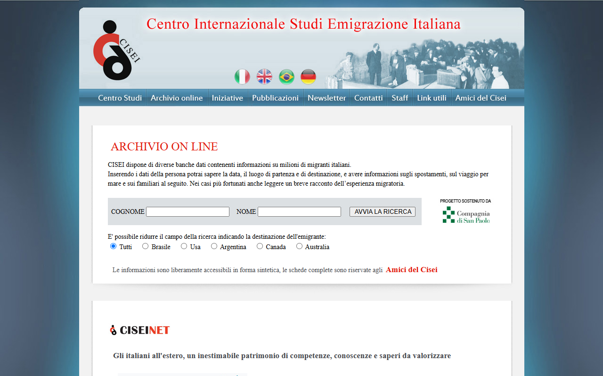
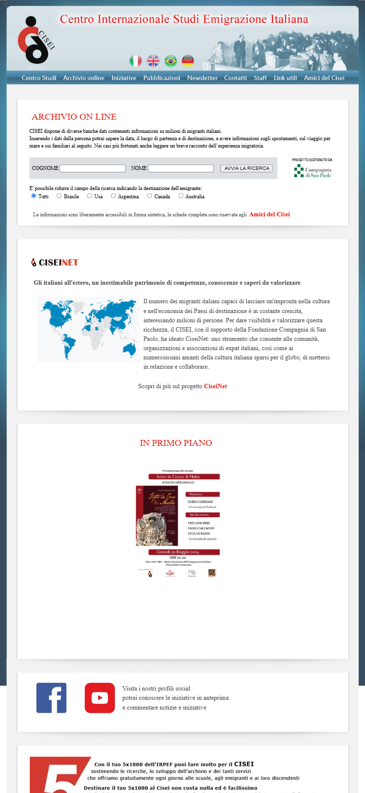

# Audit du site existant (ciseionline.it/2012)

Date de l'audit : 24/11/2026. Analyse en lecture seule des pages publiques : structure, contenu, design et technique.

> Limites : l'annuaire CiseiNet n'a été qu'échantillonné et les bases de données (`/portomondo/`, `/storiemigranti/`) n'ont pas été explorées, faute d'accord de l'association ; les mesures d'accessibilité et de performance portent sur 5 pages ; les pages DE/PT n'ont été lues que superficiellement. Les informations sont à confirmer avec l'association.
>
> Voir aussi : [benchmark de sites comparables](benchmark.md).

## 1. Résumé

Le site du CISEI (Centro Internazionale Studi Emigrazione Italiana, Gênes) est en ASP classique sur IIS, avec un contenu figé depuis 2016 environ. Il est à refaire de zéro : mise en page en tableaux à largeur fixe (945 px), menu et en-tête en images, aucune adaptation mobile, accessibilité quasi nulle, conformité RGPD défaillante.

## 2. L'association

- Fondée en 2006 (projet lancé en 2001 par l'Autorité portuaire de Gênes), siège à la Commenda di Prè, Gênes.
- Mission : conserver et valoriser la mémoire de l'émigration italienne.
- Cœur du site : une archive en ligne (plus de 3 millions de noms), recherchable par nom et destination. Fiches complètes réservées aux « Amici del CISEI » (cotisation 15 € ou 50 €).
- Autres activités : CiseiNet (réseau des communautés italiennes à l'étranger), événements, publications (collection « Dal porto al mondo »), newsletter, bibliothèque.
- Publics : descendants d'émigrés et généalogistes (parcours principal), chercheurs, musées et institutions, donateurs.
- Partenaires : Autorité portuaire, Région Ligurie, Ville et Université de Gênes, Chambre de commerce, Compagnia di San Paolo, réseau AEMI, MEI (Rome).

## 3. Structure

### Site principal `/2012/` (4 langues : it, en, de, pt)

| Rubrique | Remarque |
|---|---|
| Accueil | Recherche dans la base en premier |
| Centro Studi | Italien uniquement, avec sous-pages (siège, assemblée, conseil, comité scientifique) |
| Archives | Projet d'archive et sources |
| Initiatives | Dernier événement : 2011 |
| Publications | Dernière : 2011 |
| Newsletter | 11 numéros PDF, inscription par e-mail |
| FAQ | Anglais uniquement |
| Contacts | Carte Google Maps en ancien format |
| Staff | À mettre à jour |
| Liens utiles | ~70 liens, plusieurs cassés |
| Amis du CISEI | Adhésion : virement + bulletin |

Les langues ne sont pas à parité : certaines pages DE/PT/EN sont des copies de l'italien.

### Sous-applications séparées

- `/portomondo/` : base de données des émigrés (cœur du site).
- `/raccontimigranti/` : 8 récits de migrants.
- `/storiemigranti/` : 6 mini-bases thématiques.
- `/ciseinet/` : annuaire des communautés italiennes (Bootstrap, design plus récent).

### Documents à reprendre

11 newsletters PDF, le statut, 3 PDF de transparence (2021 à 2024, obligation légale).

## 4. Contenu : garder / mettre à jour / archiver

- **Garder** : mission, description de l'archive et de ses sources, publications 2005-2011, newsletters, pages de transparence.
- **Mettre à jour** : contacts, équipe et organes, chiffres, tarifs d'adhésion, mentions légales et RGPD, liens externes.
- **Archiver** : événements anciens, actualités antérieures à 2019 (dernière news : 2018), vidéos de 2013.
- Incohérences : copyrights différents selon les pages (2014, 2016, 2022), fautes d'anglais, caractères cassés, texte de confidentialité de 2003.

## 5. Design actuel

- **Logo** : pas de fichier séparé, intégré à l'image d'en-tête (JPEG flou). Pictogramme d'une silhouette en mouvement, rouge et noir, avec « CISEI ». À redessiner en vectoriel ou à demander à l'association.
- **Couleurs** : rouge `#e4190b` (titres, liens), gris anthracite `#46484D` (texte), bleu-acier `#376481` à `#5897b8` (en-tête et menu), fond bleu-ardoise, cartes blanches.
- **Typographie** : Times New Roman partout, texte justifié.
- **Élément fort** : photo d'archive d'émigrants en noir et blanc dans l'en-tête.
- **Mobile** : aucune adaptation (pas de meta viewport ni media queries).
- **Points forts** : structure simple (10 rubriques), recherche d'archive en premier, bon contraste du texte courant.
- **Points faibles** : logo, titre, menu et boutons en images ; largeur fixe ; hiérarchie de titres plate ; formulaire non stylé ; liens Facebook et newsletter discrets.

## 6. Audit technique

- ASP classique, IIS 10, hébergement Aruba, encodage iso-8859-1 (UTF-8 sur la version italienne), XHTML mal formé, jQuery 1.3.1 (2009, failles connues).
- Deux générations de Google Analytics chargées en parallèle (Universal, arrêté depuis 2023, et GA4, qui envoie des mesures dès le chargement). Le bandeau cookies ne s'affiche jamais (script bloqué en contenu mixte http/https, page d'information en 404) : mesure d'audience sans consentement, problème RGPD.
- Aucun en-tête de sécurité (HSTS, CSP, etc.) ; cookie de session sans HttpOnly.
- SEO : pas de sitemap, pas de `hreflang`, pas de balise canonique ; titres de page quasi identiques ; menu en image sans texte ; aucun titre H1-H6.
- Accessibilité : aucune image avec texte alternatif, pas d'attribut `lang`, formulaire sans labels.
- Performance : environ 15 requêtes et 400 Ko par page ; PDF de la newsletter n°11 de 3,6 Mo ; pas de compression.
- Redirection racine en 302 vers `/2012/index.asp` ; certificat valide jusqu'au 01/05/2027.
- Un fichier `robots.txt` liste des dossiers techniques : à ne pas reproduire dans le nouveau site, et à vérifier avec l'hébergeur (détail volontairement non publié ici).

## 6 bis. Mesures d'accessibilité et de performance

Mesures du 24/11/2026 sur 5 pages (accueil it et en, archivio, contatti, linkutili) avec Chrome headless, axe-core, Lighthouse, échantillonnage de pixels pour les contrastes et simulation clavier.

### Accessibilité

| Page | Score Lighthouse |
|---|---|
| Accueil it (`index.asp`) | 60 |
| Accueil en (`uk_index.asp`) | 56 |
| Archivio | 72 |
| Contatti | 61 |
| Linkutili | 63 |

Violations axe (nombre d'éléments) :

| Règle | it | en | archivio | contatti | linkutili |
|---|---|---|---|---|---|
| Images sans `alt` (critique) | 54 | 31 | 15 | 9 | 9 |
| Zones du menu image sans `alt` (critique) | 19 | 16 | 14 | 14 | 14 |
| Champs sans label (critique) | 8 | 8 | 8 | – | – |
| Liens-images sans nom (grave) | 11 | 2 | – | – | 1 |
| Pas d'attribut `lang` (grave) | 1 | 1 | 1 | 1 | 1 |

- Aucun titre H1-H6, aucun repère (`main`, `nav`, `header`), aucun lien d'évitement, sur les 5 pages.
- Clavier : il faut 14 tabulations pour atteindre le champ de recherche ; un lecteur d'écran annonce les entrées du menu par leur nom de fichier (« archivio.asp »).
- Contrastes : le texte HTML est globalement conforme (texte courant 9,15:1). Échecs : liens rouges `#E4190B` sur fond gris clair (4,22:1, minimum 4,5) et menu en image (4,34:1 en italien).
- Mobile : sans viewport, la page est réduite à 38 % ; le texte s'affiche à environ 5-6 px.
- 52 des 56 liens de « Liens utiles » s'ouvrent dans une nouvelle fenêtre sans le signaler.

### Performance (Lighthouse mobile / desktop)

| Page | Score | Poids | Requêtes | LCP | CLS |
|---|---|---|---|---|---|
| Accueil it | 85 / 92 | 1 369 Ko | 40 | 2,7 s / 1,1 s | 0,172 / 0,058 |
| Accueil en | 99 / 99 | 866 Ko | 23 | 1,9 s / 0,8 s | 0,022 |
| Archivio | 100 / 100 | 640 Ko | 16 | 1,2 s / 0,5 s | 0 |
| Contatti | 99 / 96 | 635 Ko | 15 | 1,8 s / 0,5 s | 0 / 0,118 |
| Linkutili | 99 / 96 | 657 Ko | 15 | 1,8 s / 0,5 s | 0 / 0,118 |

- Le site est rapide parce qu'il est léger, mais : l'image de fond `bg.jpg` (305 Ko) pèse environ 45 % des pages intérieures ; aucune mise en cache des images ; gain possible estimé à environ 600 Ko d'images.
- Accueil italien : 4 erreurs JavaScript (le diaporama est cassé) et décalages de mise en page dus aux images sans dimensions.
- Bonnes pratiques : 42 à 65 ; SEO : 92.

### Captures d'écran

Autres captures dans [`assets/captures/`](../assets/captures/).

## 7. Liens cassés

- 5 liens internes de « Liens utiles » (adresses sans `http://`), 1 PDF de newsletter mal nommé (allemand), le script du bandeau cookies.
- Une dizaine de domaines externes n'existent plus (dont le site du port de Gênes), un domaine a été repris par un autre site, une soixantaine passent par une redirection.

## 8. Recommandations

1. Site statique (Astro, Eleventy ou Hugo) avec contenu en Markdown ; CMS léger basé sur Git si plusieurs personnes publient souvent.
2. Garder les bases de données à part (sous-domaine) tant que leur source de données n'est pas comprise.
3. Mettre en avant la recherche d'archive dès l'accueil, avec un lien clair vers l'adhésion.
4. Séparer actualités récentes et archives ; aligner l'arborescence entre langues.
5. Menu en texte, accessibilité, responsive, images optimisées, PDF allégés.
6. Mettre en place `hreflang`, sitemap, redirections 301 depuis les anciennes URL, mentions légales et analytics respectueux de la vie privée.

## 9. Questions pour l'association

- Peut-on avoir les originaux : logo vectoriel, photos, couvertures de livres ?
- Qui compose l'équipe aujourd'hui ? Quels sont les contacts et tarifs actuels ?
- Garde-t-on l'allemand et le portugais ?
- Les bases de données et CiseiNet sont-elles intégrées au nouveau site ou gardées à part ?
